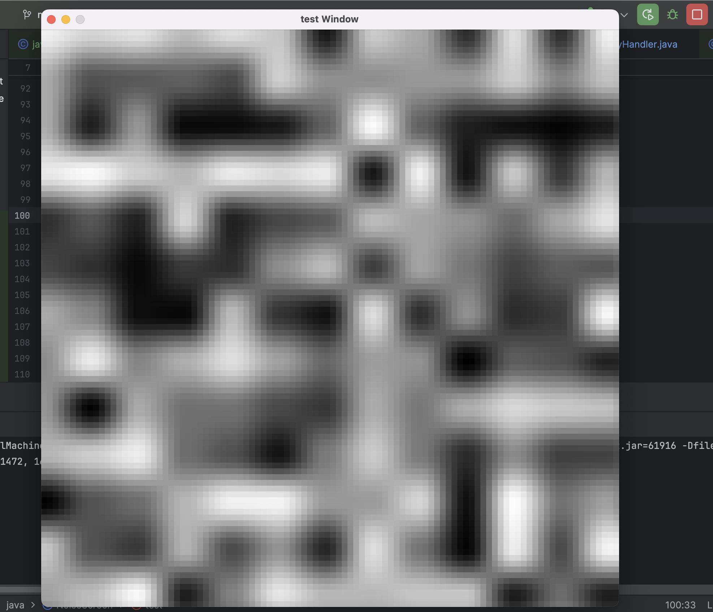
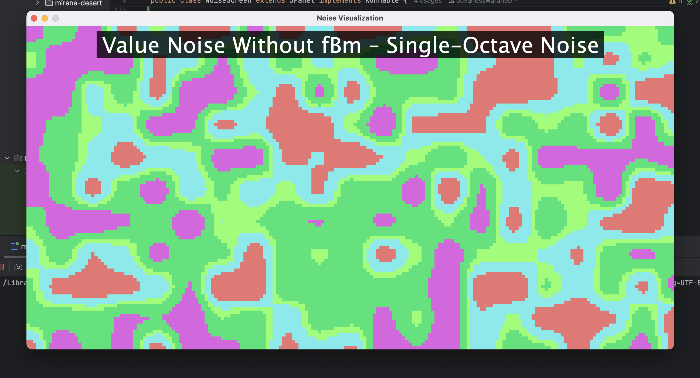
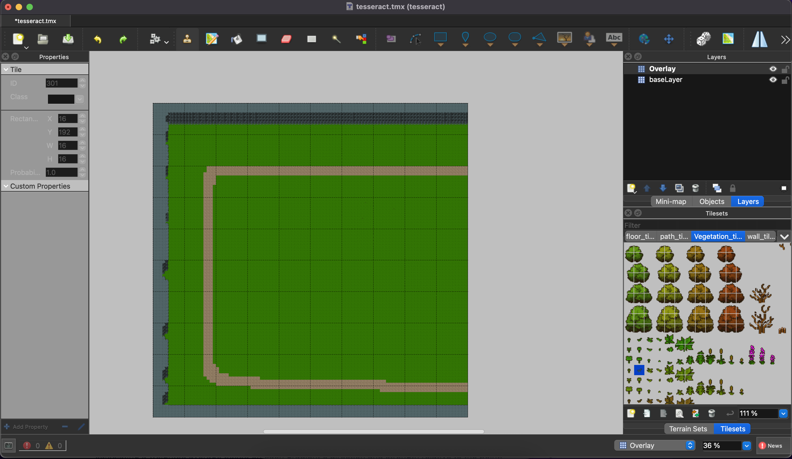
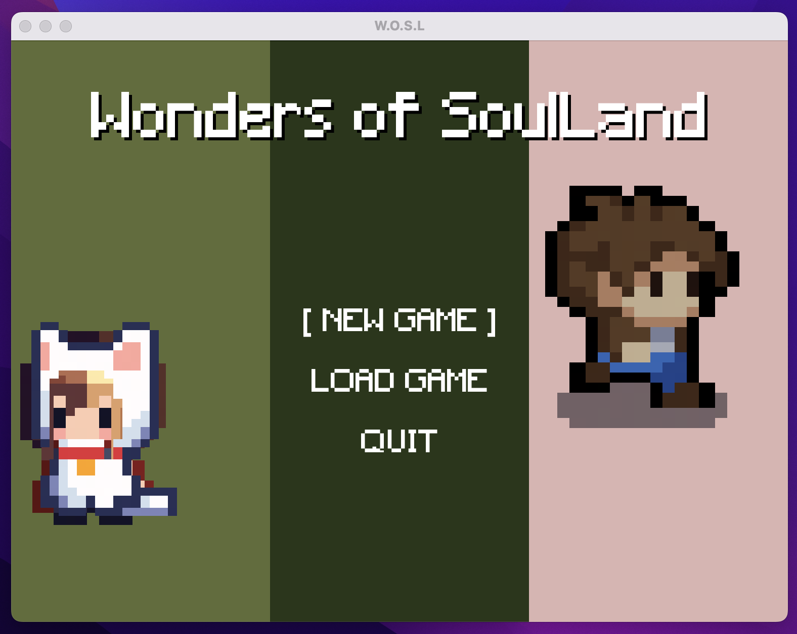
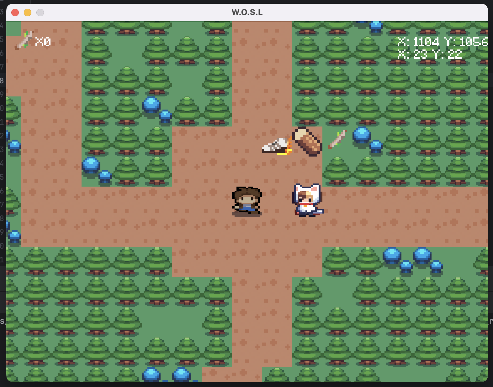
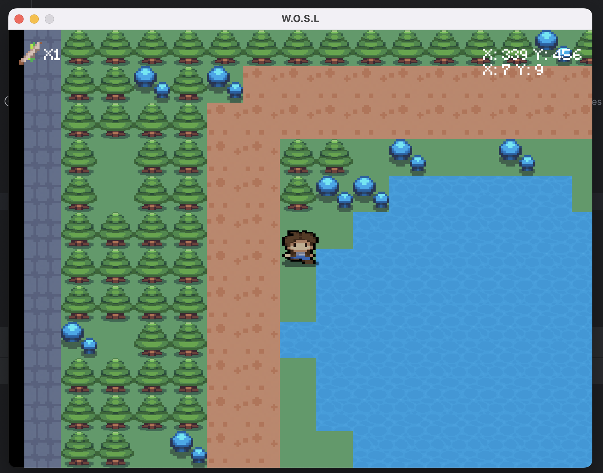

# Wonders_Of_SoulLand (Under Devlopment)
[Learning Project ] A simple a java 2d RPG game to learn the basics game devlopment

# Currently On Progress

Value Noise Implementation for procedural generation of objects such as grass, and flowers

New Map Tesseract Gate 1

# Demo 

---
# Assets

---
### Music
The Minstrels Return (Loopable) - Fantasy Medieval RPG Music

https://pixabay.com/music/folk-the-minstrels-return-loopable-fantasy-medieval-rpg-music-447849/

---
### Font
Minecraft € by Craftron Gaming

https://www.dafont.com/minecraft.font

